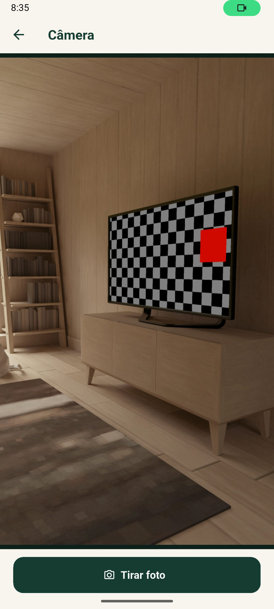
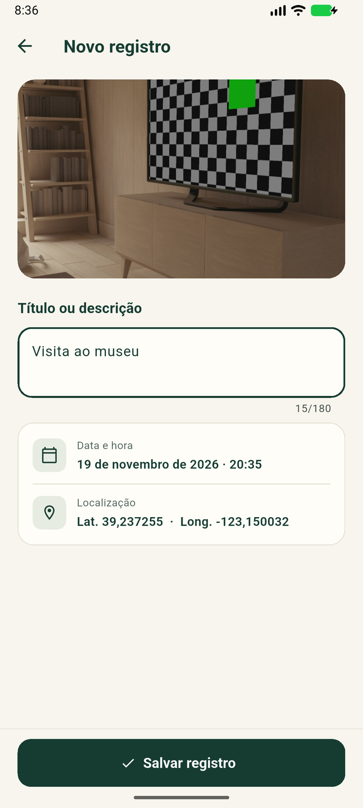
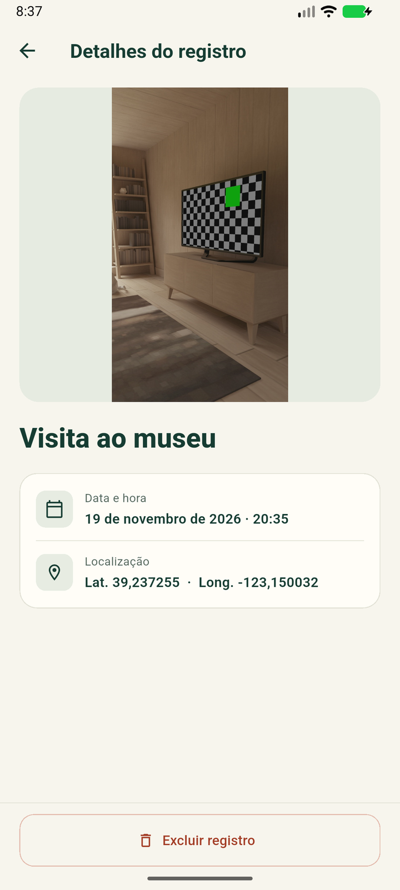

# GeoDiário

Aplicativo móvel em Flutter e Dart para guardar fotos com um título ou uma breve descrição, registrando automaticamente quando e onde foram tiradas.

## Funcionalidades

- **RF01 — Captura.** Abre a câmera do dispositivo pelo botão **Nova foto**.
- **RF02 — Informações.** No disparo, registra a data e o horário do aparelho e solicita a latitude e a longitude ao serviço de localização. A tela seguinte mostra a foto e as coordenadas e permite escrever um título ou uma descrição.
- **RF03 — Armazenamento.** Copia a fotografia para uma pasta privada do aplicativo e salva o caminho relativo e os metadados em SQLite.
- **RF04 — Consulta.** Mostra os registros na galeria do mais recente para o mais antigo.
- **RF05 — Visualização e exclusão.** Exibe a foto inteira, a descrição, a data, o horário e as coordenadas. A exclusão pede confirmação e remove o registro e sua imagem local.

O aplicativo guarda os registros no próprio dispositivo e funciona sem conexão com a internet.

## Como executar

Use o Flutter 3.41.4 com Dart 3.11.1 ou uma versão compatível. No Android, use um dispositivo ou emulador com API 24 ou superior e câmera e localização habilitadas. Para compilar para iOS, use macOS com Xcode.

```sh
flutter pub get
flutter run
```

Autorize a câmera e a localização durante o uso quando o sistema solicitar. Em um emulador Android, defina uma posição em **Extended controls** → **Location** antes de tirar a foto.

## Bibliotecas

| Biblioteca | Uso |
| --- | --- |
| `camera` | Prévia da câmera e captura da fotografia. |
| `geolocator` | Permissões e leitura da localização atual. |
| `sqflite` | Criação e acesso ao banco SQLite. |
| `path_provider` | Acesso ao diretório privado de documentos. |
| `path` | Montagem dos caminhos do banco e das imagens. |
| `intl` e `flutter_localizations` | Formatação de datas e horários e interface em português do Brasil. |

## Banco SQLite

O arquivo `geodiario.db` contém a tabela `registros`.

| Coluna | Tipo | Conteúdo |
| --- | --- | --- |
| `id` | `INTEGER PRIMARY KEY AUTOINCREMENT` | Identificador do registro. |
| `descricao` | `TEXT NOT NULL` | Título ou descrição informado. |
| `data_hora` | `INTEGER NOT NULL` | Instante da captura em milissegundos desde a época Unix. |
| `latitude` | `REAL NOT NULL` | Latitude em graus decimais, de −90 a 90. |
| `longitude` | `REAL NOT NULL` | Longitude em graus decimais, de −180 a 180. |
| `caminho_foto` | `TEXT NOT NULL UNIQUE` | Caminho da imagem relativo ao diretório de documentos do aplicativo. |

## Capturas de tela

As telas abaixo foram capturadas no emulador Android com câmera e localização simuladas.

| Câmera | Novo registro |
| :---: | :---: |
|  |  |

| Galeria | Detalhes |
| :---: | :---: |
|  |  |

## Código

- `lib/data/` contém os modelos e as operações de inclusão, consulta e exclusão.
- `lib/services/` trata permissões e leitura do GPS.
- `lib/ui/` contém a galeria, a câmera, o formulário e os detalhes.

```sh
flutter analyze
flutter test
```

## Materiais de apoio

- [Acesso à câmera e permissões](https://docs.google.com/document/d/1dli2iiNuLScHnHUGqUQpLcRWPnBNw-Dmgk_bmuqRrs0/edit)
- [Elementos de layout em Flutter](https://docs.google.com/document/d/1SqqMKgtbxBnuQX1m0DpZaR0PqcOKFcV9BcIVxEcFwu8/edit)
- [Operações CRUD com SQLite](https://docs.google.com/document/d/1_wjurS8E6aSFVVLF1GBGzAkA3x-4PL0qinlqa-oxb5c/edit)
- [Acesso ao GPS com `geolocator`](https://docs.google.com/document/d/1o11jPLMTHR0osXB9_6NfPZkYGelq_MgaKej4aU3hqCQ/edit)
